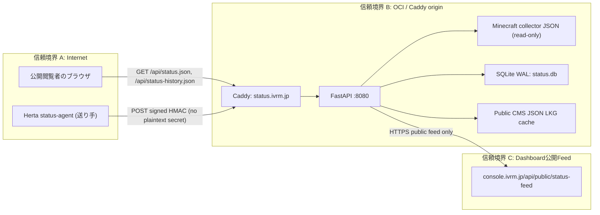
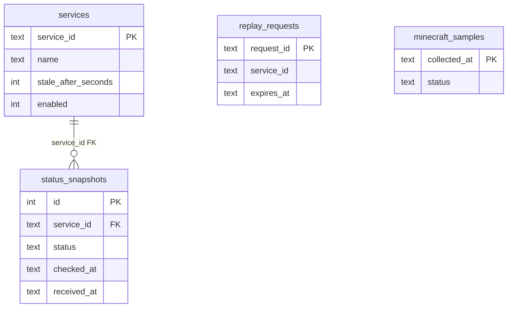
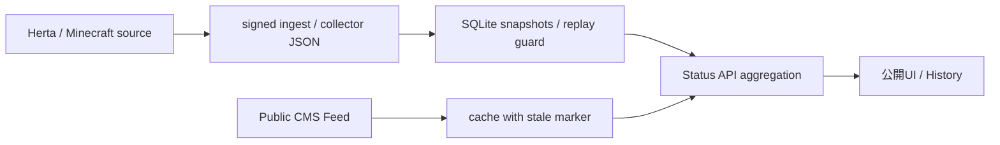
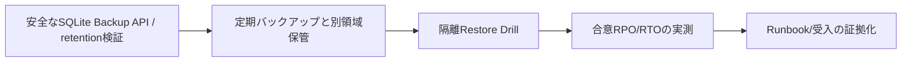

# ivRooom Status — 要件・設計・運用・品質文書（実装照合ベースライン）

照合日: 2026-10-26 JST / 正本: [Status API source](../services/status-api/app/main.py)、[DB定義](../services/status-api/app/db.py)、[Pydantic Models](../services/status-api/app/models.py)、[Workflows](../.github/workflows/)。
**ここでの「確認済み」はGitHub main実装との照合を意味する。Providerの本番稼働・バックアップの実施・受入署名の確認とは区別する。**

## 1. 要件定義（現行責務）

- 公開閲覧者は `status.ivrm.jp` でMinecraft/Hertaのサービス状況、24時間Timeline、30日履歴、Status Centerが公開したIncident/Maintenance/Announcementを確認する。
- 運用サービスは `POST /api/internal/status-ingest` にサービス固有HMAC署名でsnapshotを送信する。認証失敗はfail closed、重複request-idは拒否する。
- 公開CMSは `console.ivrm.jp/api/public/status-feed` から取得し、管理CredentialをOCI Status APIへ配置しない。
- Data源の障害時には新たな正常状態を捏造せず `unknown` または限定的なLast Known Good cache+鮮度を明示する。
- 公開本文にCookie/Secret/内部Host識別子/監査actor/raw logを混入させない。

## 2. 基本設計・システム/ネットワーク構成図

- TLS/Caddy/API ingressの実設定は [OCI deployment](oci-deployment.md) と `deploy/status-api/` を参照。
- 管理ConsoleのSupabaseにStatus APIからService Role直接接続はしない。
- `/healthz` の実際の公開範囲やIP/DNSはコードだけで確定しない。OCI設定/実通信で別途確認。

## 3. 詳細設計・APIインタフェース

| Method | Path | Client | 認証・応答 |
| --- | --- | --- | --- |
| GET | `/api/status.json` | 公開Viewer | Herta+Minecraft+CMS status、no-store |
| GET | `/api/status-history.json?days=1..30` | 公開Viewer | 既定30日、Asia/Tokyo日次・availability、no-store |
| POST | `/api/internal/status-ingest` | Herta送信Agent | 独立Shared Secret/HMAC + replay protection、202/4xx/500 |
| GET | `/healthz` | 内部readiness | SQLite read check、200/503。公開設定は環境依存 |

詳細schemaは [API contract](status-api-schema.md)、[HMAC](status-ingest-auth.md) とPydanticを正本として扱う。Consumerの破壊的変更はSchema/E2Eの双方を検証する。

## 4. DB/テーブル定義書・ER図

`services/status-api/app/db.py:StatusRepository.initialize()` から確認できるSQLite定義。

| Table | 主キー | 代表カラム・制約 | 用途 |
| --- | --- | --- | --- |
| `services` | `service_id TEXT` | `name/group_name/service_type/description` NOT NULL、`stale_after_seconds>0`、`enabled IN(0,1)` | 対象Serviceの状態設定 |
| `status_snapshots` | `id INTEGER AUTOINCREMENT` | `service_id` FK、status enum check、`checked_at/received_at`、version/summary | 受信したサービスsnapshot |
| `replay_requests` | `request_id TEXT` | `service_id/received_at/expires_at` NOT NULL | HMAC受信replay検出 |
| `minecraft_samples` | `collected_at TEXT` | `status` enum check | Collector履歴の30日保持 |

`replay_requests.service_id` にDB外部キーの定義はないため、上のERでもFK線を描かない。全列/default/indexが必要なら`db.py`が正本。初期化時 `PRAGMA journal_mode=WAL`, `foreign_keys=ON`, busy_timeout=5000、`BEGIN IMMEDIATE`でreplay検査と受信snapshot書込を原子的に実行。保存retention既定30日はenvで上書き可能。**WAL稼働中のDBファイル単純コピーを復元用backupとみなさない**。

## 5. AS-IS / TO-BE 業務フロー

AS-IS（Repo実装、クラウドでの実動作は別検証）:

TO-BE（改善・未実施）:

## 6. 運用設計・変更管理

- 公開: `GET /api/status.json` と履歴Endpointの200/JSON schema、Minecraft/Hertaのstale、CMS `content_meta` を個別確認。
- 構成: [OCI deploy guide](oci-deployment.md)。`STATUS_API_AUTO_DEPLOY` が真なら特定pathへのmain pushで本番APIデプロイが発動する。**Docs-only PRは同Workflowのpathsには含まれない**。
- UI: `.github/workflows/deploy-oci.yml` も docs-only をpathsに含まない。UI/asset/script変更では自動deploy可能なので事前に承認とrollback確認。
- Backups: `status.db` はSQLite WALで稼働。Backup API等の一貫性ある方法を設計・検証し、実機のrestore/通知は別承認。
- Rollback: 静的UIは `scripts/rollback-oci.sh`、APIは以前のimmutable GHCR SHAの再適用可否・schema/data backward compatibilityを確認。Caddyの単一ファイルbind mountはinode交換を避ける。
- セキュリティ: HMAC署名とclock skew、rate limit、request IDの一意制約。すべてのsecretはProviderへ安全に配置し、Issue/Runbookへ値を記載しない。

## 7. テスト計画・仕様・受入項目

| ID | 仕様 / 期待値 | 自動化ソース | 実行状況 |
| --- | --- | --- | --- |
| ST-01 | 公開Status JSON/unknown/staleと24h timeline | `tests/test_public_status.py` | テストコード存在。最新CI結果はActions確認 |
| ST-02 | History days=1,30/0,31拒否/Asia-Tokyo集計 | `tests/test_public_status.py` | テストコード存在。最新CI結果はActions確認 |
| ST-03 | HMAC: 署名/時間/本文/ID/rate/replay | `tests/test_ingest.py` | テストコード存在。最新CI結果はActions確認 |
| ST-04 | CMS正常/期限切れ/障害時cache | `tests/test_public_content.py` と cache tests | テストコード存在。最新CI結果はActions確認 |
| ST-05 | GHCR ARM64 Build/OCI Caddy deploy | `status-api-ci.yml`, `deploy-status-api.yml` | CI !=本番成功 |
| ST-06 | SQLite backup→隔離restore→timed RPO/RTO | 実環境用独立Runbook必要 | **未確認・受入不可** |
| ST-07 | 公開画面の匿名/Keyboard/Mobile/JA+EN表示 | `ci.yml` + 手動UAT | 結果未集計 |

テスト実績の正本: GitHub ActionsのRun URL/Commit SHA/Artifacts。BugはGitHub Issuesに`ST-`ID・期待/実際・再現手順・証拠を紐付ける。検収は承認者・受入日時・対象SHA・実施環境の合格証拠が揃うまで**未判定**。

## 8. 移行計画・未解決

このドキュメントで本番データ移行やBackup基盤の構築はしない。必要な改善は Issue→Snapshot/Backup→隔離restore→Change approval→CI→Deploy→Smoke→Acceptance の順で個別PR管理。現行SQLiteをDedicated PG17へ移した事実・計画は確認していないため移行済みと記載しない。
